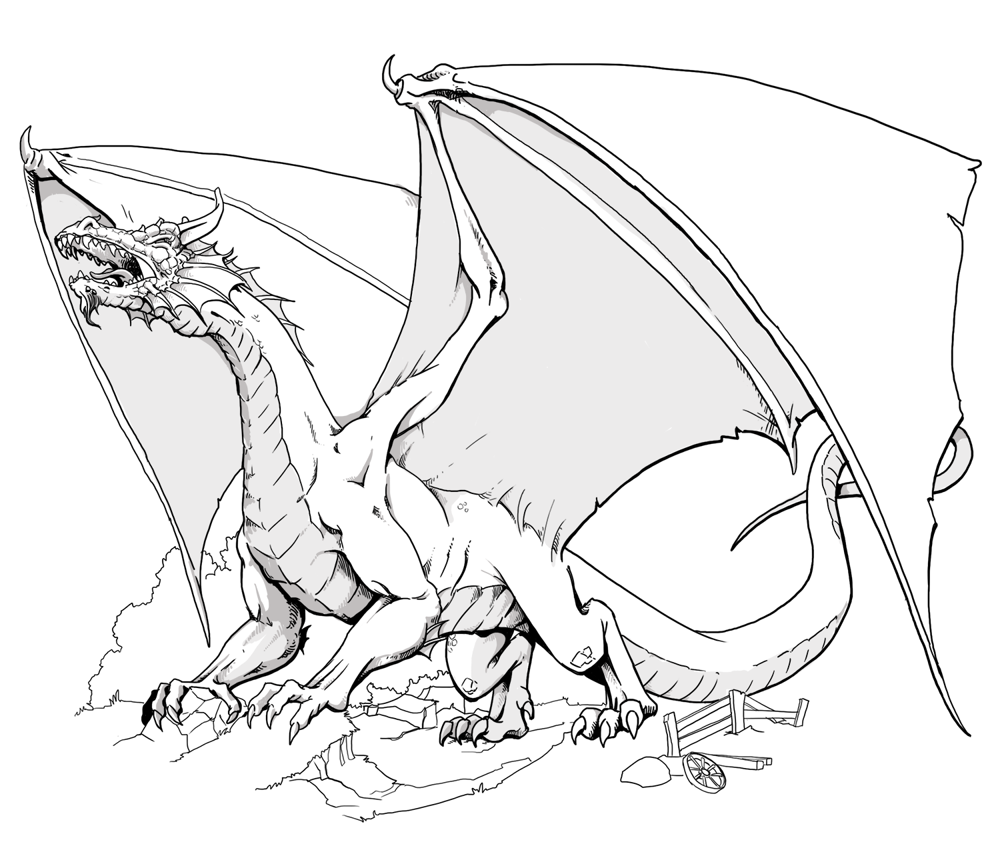

# Images {#images}

Here few examples of with images.

## Centered image with caption {#centered-image-with-caption}

](img/cover.png){width="60%" framed=true}

# Columns

Example of how to create columns using "[paracol](https://ctan.org/pkg/paracol)". By default the column separator is 1cm.

:::::::::::::: {.columns }
::: {.column width="50%"}
{width="100%" framed=true}
:::
::: {.column width="50%" }
Lorem Ipsum comenzó como un latín revuelto y sin sentido derivado del texto de Cicerón del siglo I aC De Finibus Bonorum et Malorum. Lorem Ipsum comenzó como un latín revuelto y sin sentido derivado del texto de Cicerón del siglo I aC De Finibus Bonorum et Malorum. Lorem Ipsum comenzó como un latín revuelto y sin sentido derivado del texto de Cicerón del siglo I aC De Finibus Bonorum et Malorum. Lorem Ipsum comenzó como un latín revuelto y sin sentido derivado del texto de Cicerón del siglo I aC De Finibus Bonorum et Malorum.
:::
::::::::::::::

You can change the colsep adding an attribute:

:::::::::::::: {.columns columnsep="2cm"}
::: {.column width="50%"}
{width="100%" framed=true}
:::
::: {.column width="50%" }
Lorem Ipsum comenzó como un latín revuelto y sin sentido derivado del texto de Cicerón del siglo I aC De Finibus Bonorum et Malorum. Lorem Ipsum comenzó como un latín revuelto y sin sentido derivado del texto de Cicerón del siglo I aC De Finibus Bonorum et Malorum. Lorem Ipsum comenzó como un latín revuelto y sin sentido derivado del texto de Cicerón del siglo I aC De Finibus Bonorum et Malorum. Lorem Ipsum comenzó como un latín revuelto y sin sentido derivado del texto de Cicerón del siglo I aC De Finibus Bonorum et Malorum.
:::
::::::::::::::

You can add more columns.

:::::::::::::: {.columns }
::: {.column width="33%"}
Lorem Ipsum comenzó como un latín revuelto y sin sentido derivado del texto de Cicerón del siglo I aC De Finibus Bonorum et Malorum. Lorem Ipsum comenzó como un latín revuelto y sin sentido derivado del texto de Cicerón del siglo I aC De Finibus Bonorum et Malorum. Lorem Ipsum comenzó como un latín revuelto y sin sentido derivado del texto de Cicerón del siglo I aC De Finibus Bonorum et Malorum. Lorem Ipsum comenzó como un latín revuelto y sin sentido derivado del texto de Cicerón del siglo I aC De Finibus Bonorum et Malorum.
:::
::: {.column width="33%" }
{width="100%" framed=true}
:::
::: {.column width="33%"}
Lorem Ipsum comenzó como un latín revuelto y sin sentido derivado del texto de Cicerón del siglo I aC De Finibus Bonorum et Malorum. Lorem Ipsum comenzó como un latín revuelto y sin sentido derivado del texto de Cicerón del siglo I aC De Finibus Bonorum et Malorum. Lorem Ipsum comenzó como un latín revuelto y sin sentido derivado del texto de Cicerón del siglo I aC De Finibus Bonorum et Malorum. Lorem Ipsum comenzó como un latín revuelto y sin sentido derivado del texto de Cicerón del siglo I aC De Finibus Bonorum et Malorum.
:::
::::::::::::::

# Tables {#tables}

Few examples of tables

## Table 1

Custom tablename "yukitblr":

| Head 1 | Head 2  | Head 3 |
|:-------|:-------:|-------:|
| [Alpha]{.verbatim}  | Beta    | Gamma  |
| Delta  | Epsilon | Zeta   |
| Eta    | Theta   | Iota |
| [Alpha]{.verbatim}  | Beta    | Gamma  |
| Delta  | Epsilon | Zeta   |
| Eta    | Theta   | Iota |
| [Alpha]{.verbatim}  | Beta    | Gamma  |
| Delta  | Epsilon | Zeta   |
| Eta    | Theta   | Iota |
| [Alpha]{.verbatim}  | Beta    | Gamma  |
| Delta  | Epsilon | Zeta   |
| Eta    | Theta   | Iota |

Table: Table content {tablename=yukitblr}

## Table 2
Custom tablename "yukitblrcol":

|        | Head 2  | Head 3 |
|:-------|:-------:|-------:|
| Alpha  | Beta    | Gamma  |
| Delta  | Epsilon | Zeta   |
| Eta    | Theta   | Iota |

Table: [link](https://github.com/yuki/my-books) {tablename=yukitblrcol}

## Table 3
Custom tablename "rubrica" with custom "colspec" like "X[-1]X[2]X[2]X[2]X[2]" in the Caption (see the source):

| |Excelente | Notable | Mejorable| Muy mejorable  |
|--------|---------|---------|---------|---------|
| Alpha  | Beta    | Gamma   | Beta    | Gamma   |
| Delta  | Epsilon | Zeta    | Epsilon | Zeta    |
| Eta    | Theta   | Iota    | Theta   | Iota    |

Table: {tablename=rubrica colspec=X[-1]X[2]X[2]X[2]X[2]}

